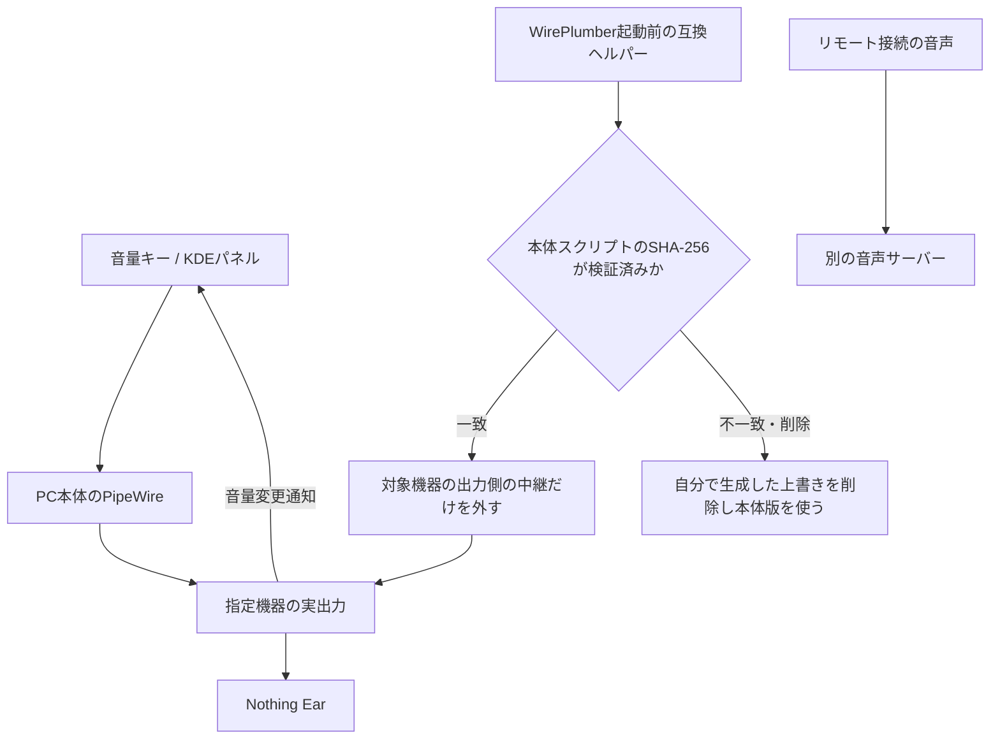

# Nothing Ear audio fix for KDE

KDE Plasma / PipeWire / WirePlumber環境で起きるNothing Earの音量不整合を調査し、対象機器に復旧設定を適用するツールです。Pythonの追加パッケージとroot権限は不要です。

2026年11月6日の調査で、音量キーを押しても63%と73%を行き来する症状を再現しました。直接指定なら別の音量を保持できますが、Bluetoothの中継出力からKDEへ音量変更通知が届かず、KDEは古い68%を基準に±5%を計算していました。**特定の百分率が音量の上限だったわけではありません。**

## 対策する問題

| 問題 | 観測したこと | 対策 |
|---|---|---|
| 音量キーが2つの値を行き来する | 下げる処理を3回呼んでも63→63→63%、上げても73→73→73%。音量の変更通知が届かない | 検証済みのWirePlumber 0.5.13に限り、指定機器の出力側の中継だけを外す |
| Bluetooth音量の不一致 | 過去の調査では29%を指定して読み戻すと9%になった | 指定機器のハードウェア音量連動を無効にする |
| 音声サーバーの取り違え | 過去にChrome Remote Desktop由来の環境変数がWirePlumberへ継承され、PC本体の出力が消えた | WirePlumber・Plasmaパネル・音量キーを処理するKDEDの接続先をPC本体に固定する |

以前の音量連動の問題は、イヤホン・PipeWire・WirePlumberのどこで値が変換されたかまでは特定していません。音声サーバーの取り違えも、過去の症状すべてを説明するものではありません。

今回の中継出力の問題には、WirePlumber上流の[出力側の中継を削除する修正](https://github.com/PipeWire/wireplumber/commit/83d08dfa4370)があります。本ツールはその方針を指定機器に限定して適用し、マイク側の中継と通話モードの自動切替は維持します。

## 仕組み



図の注釈：音量変更通知がKDEへ戻る経路を示しています。PC本体のサービスだけに接続先を指定し、リモート用サービスは編集しません。生成する上書きはユーザー用のファイルで、`/usr/share`の本体スクリプトは変更しません。

- `bluez5.hw-volume = [ ]`で、指定機器の音量をPC側で調整します。
- 互換ヘルパーは本体のスクリプトをSHA-256で照合してから生成します。対応対象は現在、実機検証したUbuntuのWirePlumber 0.5.13のスクリプト1種類です。版番号だけでは判断しません。
- 本体のスクリプトが更新された場合、次のWirePlumber起動時に本ツールの上書きを外します。未検証の版へ古いスクリプトを被せ続けません。
- 別の目的で作成された`bluez.lua`やシンボリックリンクは上書きしません。
- 元のマイク処理を残し、対象外のBluetooth機器には中継回避を適用しません。

未対応の本体スクリプトでは、中継回避を適用せず、その旨を表示します。音量同期の無効化とサービスの接続先固定は引き続き適用します。本ツールがすべてのNothing EarやLinux環境で同じ問題を解消する保証はありません。

## 必要な環境

- KDE Plasma 6、systemdユーザーサービス、WirePlumber 0.5系の設定形式
- Bash、Python 3.9以降、`pactl`、`flock`と一般的なLinuxコマンド
- `wireplumber.service`、`plasma-plasmashell.service`、`plasma-kded6.service`
- PC本体の音声サーバーが`pipewire-0`と`/run/user/<UID>/pulse/native`を使う構成

実機確認環境はPlasma 6.6.5、PipeWire 1.6.2、WirePlumber 0.5.13、BlueZ 5.85です。リモート接続中の音声との同時利用、別のデスクトップ、独自の音声ソケット配置は未検証です。

## インストール・更新

新規に取得する場合：

```bash
git clone https://github.com/novelsavage/nothing-ear-audio-fix.git
cd nothing-ear-audio-fix
```

取得済みのリポジトリを更新する場合：

```bash
cd /path/to/nothing-ear-audio-fix
git pull --ff-only
```

**旧版の単体スクリプトに加えて、互換ヘルパーもインストールしてください。**

```bash
install -Dm755 nothing-ear-loopback-compat.py ~/.local/libexec/nothing-ear-loopback-compat.py
install -Dm755 nothing-ear-audio-fix ~/.local/bin/nothing-ear-audio-fix

# 新規設定時は、自分の機器アドレスを確認
bluetoothctl devices
# ダミーアドレスを実際の値に置き換える
NOTHING_EAR_ADDRESS=AA:BB:CC:DD:EE:FF ~/.local/bin/nothing-ear-audio-fix apply

# 旧版ですでに設定済みなら保存済みのアドレスを使える
# ~/.local/bin/nothing-ear-audio-fix apply
```

実機のアドレスはローカルの状態ディレクトリに保存し、このリポジトリには含めません。機器を変える場合はいったん`undo`してから設定してください。

設定変更時は音声管理、パネル、KDEDを再起動するため、音声が途切れ、パネルが一時的に消えます。再起動前の標準出力が残っている場合は、その出力・音量・ミュート状態へ戻します。残っていない場合は対象のBluetooth出力を選びます。Bluetoothの接続状態によりプロファイルが変わる場合があるため、再起動後に音楽モードを確認してください。

A2DPが一覧に現れず通話モードしか選べなくなった場合は、Bluetooth設定から対象機器を一度切断・再接続してください。検証中にもWirePlumber再起動後にこの状態が発生し、再接続でA2DPへ復帰しました。ツールが勝手にBluetoothを切断することはありません。

## 操作

| コマンド | 動作 |
|---|---|
| `nothing-ear-audio-fix apply` | 設定と互換対策を適用。内容が同じなら再起動しない |
| `nothing-ear-audio-fix check` | 接続先・標準出力・音量・対象機器の出力名・互換対策の状態・KDE音量変更音の設定を表示 |
| `nothing-ear-audio-fix restart` | 音声管理を再起動し、対象出力を最大15秒待ってからパネルとKDEDを再起動 |
| `nothing-ear-audio-fix enable-auto` | 約5秒間隔の接続監視を有効化 |
| `nothing-ear-audio-fix disable-auto` | 接続監視を停止。アドレスの状態ファイルがなくても停止可能 |
| `nothing-ear-audio-fix undo` | 監視を停止し、適用前の設定へ復元 |

引数なしは`apply`です。`~/.local/bin`がPATHにない場合はフルパスで実行してください。`restart`は設定を修復しないため、設定を消した場合は`apply`を使います。

`check`の互換対策欄はJSONです。`vendor_supported: true`は検証済みの本体、`current: true`は指定機器向けの生成内容と一致することを示します。これはディスク上の状態確認であり、キー操作の実測テストではありません。

テスト音はKDEの「音量変更時のフィードバック音」という別の設定です。本ツールは設定値を表示するだけで変更しません。

## 接続時の自動実行

```bash
nothing-ear-audio-fix enable-auto
# ログを確認
journalctl --user -u nothing-ear-audio-fix.service -n 30
# 停止
nothing-ear-audio-fix disable-auto
```

対象出力が現れたとき、一度だけ`apply`と標準出力への切替を実行します。コロンを含む出力名と、アンダースコア・末尾番号を含む出力名の両方に対応しています。修復の再起動で名前が変わった場合は、再取得してから選択します。

接続が続く間は、手動の出力先や音量操作に介入しません。音声サーバーへの問い合わせが失敗した場合は、切断とみなして接続状態を消すこともしません。手動操作と監視処理は共通のロックで直列化します。短い切断は見逃す場合があり、切断中にBluetoothを自動接続する機能はありません。

## 管理するファイルと復元

設定ルート（通常は`~/.config`）：

```text
systemd/user/wireplumber.service.d/10-local-audio.conf
systemd/user/wireplumber.service.d/20-nothing-ear-volume-compat.conf
systemd/user/plasma-plasmashell.service.d/10-local-audio.conf
systemd/user/plasma-kded6.service.d/10-local-audio.conf
wireplumber/wireplumber.conf.d/51-nothing-ear-volume.conf
systemd/user/nothing-ear-audio-fix.service  # enable-autoで作成
systemd/user/nothing-ear-audio-fix.timer    # enable-autoで作成
```

データルート（通常は`~/.local/share`）：

```text
wireplumber/scripts/monitors/bluez.lua  # 検証済みの本体に限り生成
```

`XDG_CONFIG_HOME`、`XDG_DATA_HOME`、`XDG_STATE_HOME`に対応しています。独自のXDG設定を使う場合は、手動実行とsystemdユーザーサービスで同じ値を使ってください。実行ファイルは上記の`~/.local/bin`と`~/.local/libexec`へインストールする前提です。

復元用バックアップは`~/.local/state/nothing-ear-audio-fix/backup/`へ保存します。旧版から更新したときも、旧版のバックアップを維持したうえで新しく管理するファイルだけを追加で記録します。`undo`は初回状態を復元するため、適用後に管理対象を手で編集した内容も戻ります。以前から手動で入れていた対策は初回状態として残る場合があります。

`undo`はタイマーを停止しますが、無効化したservice/timerファイルとインストールした実行ファイルは残します。出力先の選択履歴やサービス内部の状態は復元対象外です。

## 検証

```bash
bash -n nothing-ear-audio-fix
shellcheck nothing-ear-audio-fix tests/integration.sh
python3 -m unittest discover -s tests -p 'test_*.py' -v
bash tests/integration.sh
```

テストは一時ディレクトリと偽の`systemctl`・`pactl`を使い、実際の音声サービスを変更しません。Pythonテストでは機器の限定、マイク処理の維持、本体更新時の自動解除、他の上書き・シンボリックリンクの保護を確認します。Luaの動作確認にはLua 5.4の実行ファイル、または共有ライブラリを使います。どちらもなければその項目だけスキップし、CIではLuaを用意して実行します。

実機では2026年11月6日に、対策前の63%/73%固定を再現しました。対策後は通話モードとステレオA2DPの両方で60→55→50→45→50→55→60%と調整でき、音量変更通知も復旧しました。Bluetooth再接続後の動作、Fn+F2/F3での段階的な調整、テスト音が鳴らないことも確認しています。テスト音の無効化は別途KDEで行った設定です。長期間の再発防止と実機での`undo`は未確認です。

## 参考資料

- [WirePlumber: 出力側の中継を削除した上流修正](https://github.com/PipeWire/wireplumber/commit/83d08dfa4370)
- [WirePlumber: リリースノート（0.5.14に修正を収録）](https://pipewire.pages.freedesktop.org/wireplumber/resources/releases.html)
- [WirePlumber: Bluetooth configuration](https://pipewire.pages.freedesktop.org/wireplumber/daemon/configuration/bluetooth.html)
- [WirePlumber: ユーザー用スクリプトの検索場所](https://pipewire.pages.freedesktop.org/wireplumber/daemon/locations.html)
- [systemd.exec: Environment / UnsetEnvironment](https://www.freedesktop.org/software/systemd/man/latest/systemd.exec.html)
