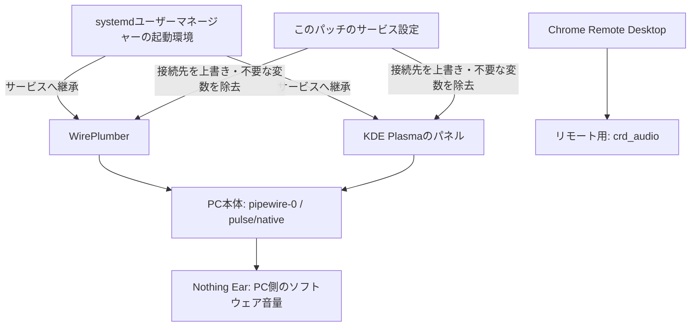

# Nothing Ear audio fix for KDE

KDE Plasma / PipeWire / WirePlumber環境で発生したNothing Earの音量不整合を調査し、復旧設定を適用するBashスクリプトです。Chrome Remote Desktopと同じユーザーで音声サービスを使う環境を想定しています。

**特定環境での回避策です。Nothing Ear全般の不具合や、38%という上限の存在を示すものではありません。**

## 何が起きていたか

症状は、キーを押しても音量表示が動かない、スライダーで調節した後にキーを押すと元の音量を基準にしてしまう、38%を超えられない、というものでした。調査で確認した現象は二つあります。

| 現象 | 観測したこと | 対策と確認範囲 |
|---|---|---|
| Bluetooth音量の不一致 | `pactl`で29%を指定した後、読み戻すと9%になった | 対象機器のハードウェア音量連動を無効化。その後20%→15%→10%の設定・保持を確認 |
| 音声サーバーの取り違え | systemdユーザーマネージャーの環境に`PIPEWIRE_REMOTE=crd_audio/pipewire`、`PULSE_RUNTIME_PATH`、`PULSE_SINK=chrome_remote_desktop_session`が入っていた。再起動したWirePlumberプロセスにも継承され、PC本体側の出力が消えた | WirePlumberとPlasmaのサービス接続先をPC本体へ固定。Nothing Ear出力の復帰と35%→40%の設定・保持を確認 |

最初の現象はBluetoothの音量連動に関係する可能性が高いものの、イヤホン・PipeWire・WirePlumberのどこで値が変換されたかは特定していません。

二つ目は調査中のサービス再起動で実際に確認しました。環境変数を誰が・いつユーザーマネージャーへ登録したかは追跡していません。**これだけで元の「38%で止まる症状」の原因を断定することもできません。** 40%はコマンドで設定できていたため、38%が音声バックエンドの固定上限だった証拠はありません。

パネル再起動だけでは改善しませんでした。再起動自体がリモート用の環境変数を継承する場合があり、単なる再起動より先に接続先を固定する必要がありました。

## 仕組み



図の注釈：二つの音声サーバーを分けて示しています。パッチはPC本体用のWirePlumberとパネルに限定して接続先を指定し、リモート用サービス自体の設定は編集しません。リモート接続中の音声利用への影響は未検証です。

- `PIPEWIRE_REMOTE=pipewire-0`：WirePlumberとパネルのPipeWire接続先をPC本体へ指定。
- `PULSE_SERVER=unix:/run/user/<UID>/pulse/native`：パネルのPulseAudio互換接続先をPC本体へ指定。
- `UnsetEnvironment=`：対象サービスからリモート用の音声変数を除去。
- `bluez5.hw-volume = [ ]`：指定したBluetooth機器でハードウェア音量連動を使わず、PC側で調節。

サービス起動時の設定適用に加え、任意で接続監視タイマーを有効にできます。再発を完全に防ぐ保証ではありません。

## 必要な環境

- Bash、systemdのユーザーサービス、`pactl`、一般的なLinuxコマンド
- KDE Plasmaの`plasma-plasmashell.service`と`wireplumber.service`
- WirePlumber 0.5系以降の設定形式
- ローカルの音声サーバーが`pipewire-0`と`/run/user/<UID>/pulse/native`を使用する構成

実機確認はPipeWire 1.6.2のKDE環境。別のデスクトップや独自のソケット配置は対象外です。root権限は使いません。

## インストール・初回適用

```bash
git clone https://github.com/novelsavage/nothing-ear-audio-fix.git
cd nothing-ear-audio-fix
install -Dm755 nothing-ear-audio-fix ~/.local/bin/nothing-ear-audio-fix

# 自分のイヤホンのアドレスを調べる
bluetoothctl devices

# 以下のダミーアドレスを実際の値に置き換える
NOTHING_EAR_ADDRESS=AA:BB:CC:DD:EE:FF ~/.local/bin/nothing-ear-audio-fix apply
```

アドレスは初回適用でローカルの状態ディレクトリに保存します。このリポジトリには実機のアドレスを含めていません。対象機器を変える場合は、いったん`undo`してから新しいアドレスで適用してください。

設定が変わると音声管理とパネルを再起動するため、音声が途切れ、パネルが一時的に消えます。音量値は変更しません。再起動後に対象イヤホンが見つかった場合は標準出力に設定します。切断中は自動接続しません。

## 操作

| コマンド | 動作 |
|---|---|
| `nothing-ear-audio-fix apply` | 設定を適用。内容が同じなら再起動を省略 |
| `nothing-ear-audio-fix check` | サービスの状態・設定、PC本体の標準出力と音量を確認 |
| `nothing-ear-audio-fix restart` | 音声管理とパネルを再起動し、対象機器を最大15秒待つ |
| `nothing-ear-audio-fix undo` | 初回適用直前の設定へ復元し、サービスを再起動 |

引数なしは`apply`です。`~/.local/bin`がPATHにない場合はフルパスで実行してください。`restart`は設定ファイルを修復しないため、ファイルを消した場合は`apply`を使います。

## 変更するファイルと取り消し

`~/.config`（`XDG_CONFIG_HOME`指定時はその場所）以下の3ファイルを管理します。

```text
systemd/user/wireplumber.service.d/10-local-audio.conf
systemd/user/plasma-plasmashell.service.d/10-local-audio.conf
wireplumber/wireplumber.conf.d/51-nothing-ear-volume.conf
```

初回適用直前の内容は`~/.local/state/nothing-ear-audio-fix/backup/`へ保存します。`XDG_STATE_HOME`にも対応しています。同名ファイルがある場合はバックアップ後に置き換えます。

`undo`は既存ファイルを復元し、新規作成したファイルを削除します。**以前に手動で同じ対策をしていた場合、その手動対策は残ります。** 既定のOS設定へ戻す機能ではありません。適用後に対象ファイルを手で編集した場合、undoはその編集も初回状態へ戻します。標準出力の選択履歴やサービス内部の状態はバックアップ対象外です。

## 検証

```bash
bash -n nothing-ear-audio-fix
bash tests/integration.sh
```

統合テストは一時ディレクトリと偽の`systemctl`・`pactl`を使い、実際の音声サービスを変更しません。入力検証、機器アドレスの反映、再適用時の再起動省略、バックアップ復元、新規ファイルの削除、undo後の再適用を確認します。

実機ではサービスの接続先固定、出力の復帰、40%の保持を確認しました。最終確認時はイヤホンが切断中だったため、キーボード・スライダーの追従、長期間の再発防止、実機でのundoは未確認です。

## 参考資料

- [WirePlumber: Bluetooth configuration](https://pipewire.pages.freedesktop.org/wireplumber/daemon/configuration/bluetooth.html)
- [PipeWire: bluez5.hw-volumeなどのプロパティ](https://pipewire.pages.freedesktop.org/pipewire/devel/page_man_pipewire-props_7.html)
- [systemd.exec: Environment / UnsetEnvironment](https://www.freedesktop.org/software/systemd/man/latest/systemd.exec.html)


## Nothing Ear接続時の自動実行

インストールと初回applyの後に実行します。

```bash
nothing-ear-audio-fix enable-auto
```

systemdユーザータイマーがログイン中に約5秒間隔でPC本体の音声出力一覧を確認します。対象の出力が現れたとき、一度だけapplyと標準出力の切り替えを実行します。Bluetoothの物理接続そのものではなく、音声出力の出現を検知します。接続したままの間は音量操作や別の出力先への手動切り替えに介入しません。

設定が正常ならサービスを再起動しません。設定が変わっていれば修復時に音声管理とパネルを再起動します。音量値は変更しません。非常に短い切断・再接続は検知できない場合があります。初回有効化時にすでに接続中なら一度実行します。切断中に自動接続する機能はありません。

```bash
# 自動実行を停止
nothing-ear-audio-fix disable-auto
# 実行ログ
journalctl --user -u nothing-ear-audio-fix.service -n 30
```

追加ファイルは`~/.config/systemd/user/nothing-ear-audio-fix.{service,timer}`です。`undo`も先に監視を停止するため、復元した設定が直後に再適用されることを防ぎます。再ログイン後もタイマーは起動します。`flock`を使用して同時実行を防ぎます。
